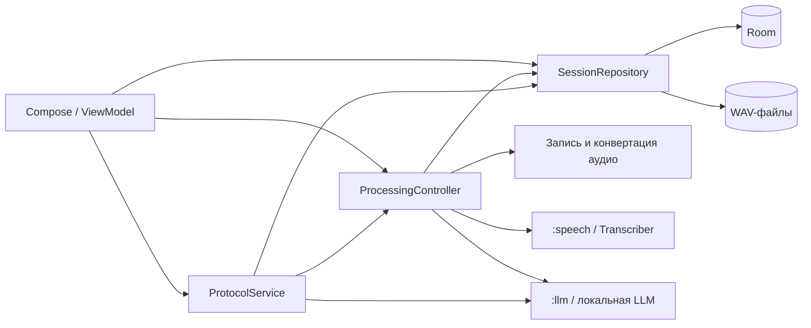
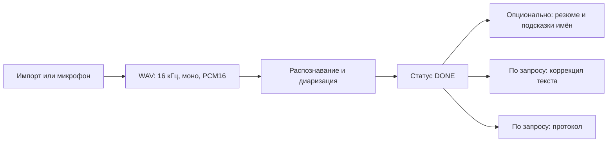

# Архитектура модуля `:app`

**OnWin** — офлайн-приложение для записи и расшифровки разговоров с разделением по говорящим и
таймкодами. Распознавание и доступные функции локальной LLM выполняются на устройстве. Модуль `:app`
объединяет интерфейс, хранение и обработку аудио; за движки отвечают отдельные модули.

## Модули проекта

| Модуль             | Ответственность                                                                            |
|--------------------|--------------------------------------------------------------------------------------------|
| `:app`             | Экран приложения, навигация, запись и импорт аудио, очередь обработки, хранение и экспорт. |
| `:speech`          | Распознавание речи, диаризация и контракты анализа текста.                                 |
| `:llm`             | Локальный генератор на ONNX Runtime GenAI и реализации функций обработки текста.           |
| `:baselineprofile` | Генерация baseline profile и измерение холодного запуска.                                  |

Подробнее о движках: [`speech/README.md`](../speech/README.md) и [
`llm/README.md`](../llm/README.md).

## Устройство `:app`

Код разделён на пакеты по ответственности, а не на отдельные Gradle-модули:

| Пакет    | Содержимое                                                                                |
|----------|-------------------------------------------------------------------------------------------|
| `ui`     | Compose-экраны, ViewModel, навигация и foreground-сервис с уведомлениями.                 |
| `domain` | Модели сессий, контракты репозиториев и устройств, контроллер очереди и сервис протокола. |
| `data`   | Room и DataStore, реализация репозиториев, запись и конвертация аудио, экспорт.           |

Интерфейс использует Compose Material 3, `ViewModel`, `StateFlow` и Navigation Compose с
типобезопасными маршрутами. `OnWinNavigationLayout` содержит общую навигационную панель. Контракты
обработки и хранения находятся в `domain`; конкретные реализации связываются через Hilt. Domain-код
также использует API модуля `:speech` и стандартные классы JVM.

## Запись и обработка

`DefaultProcessingController` — singleton в Hilt и владелец FIFO-очереди обработки. Один воркер
выполняет задания последовательно; у каждого задания своя корутина, поэтому отдельное задание можно
отменить. Запись с микрофона идёт независимо от воркера и занимает место в очереди при запуске. Если
поддерживается потоковое распознавание, контроллер может читать растущий WAV во время записи; иначе
обработка начинается после подготовки файла. Если очередь занята, запись продолжается, ожидая своей
очереди.

- **Импорт.** `AudioConverter` использует `MediaExtractor`, `MediaCodec` и потоковый `PcmPipeline`;
  для поддерживаемых WAV при отсутствии декодера `audio/raw` предусмотрен `RiffWavReader`. Повторная
  обработка может использовать ранее сохранённый WAV.
- **Распознавание.** `Transcriber` из `:speech` выдаёт сегменты по мере готовности. Они сохраняются
  в Room; по завершении итоговый список заменяет промежуточный.
- **Анализ.** После успешного распознавания сессия получает статус `DONE`. Если анализатор доступен
  и есть сегменты, контроллер отдельно пытается сохранить резюме и подсказки имён. Ошибка анализа не
  превращает успешную расшифровку в ошибочную.
- **Коррекция.** `correctTranscript` запускается по действию пользователя для готовой сессии. Она не
  является автоматическим этапом обработки.
- **Протокол.** `ProtocolService` формирует его по запросу для готовой сессии. При занятой обработке
  или недоступных моделях запуск отклоняется. Доступ к моделям синхронизируется с контроллером;
  модель освобождается после запроса.

Для анализа контроллер освобождает модели распознавания перед загрузкой LLM. Модели могут
переиспользоваться внутри пачки, когда это позволяет следующий этап, и освобождаются при опустошении
очереди. LLM-функции недоступны, если `OnDeviceLlm` не удалось создать.

При старте процесса контроллер переводит незавершённые сессии в `FAILED` с кодом `INTERRUPTED` и
очищает осиротевшие WAV и временные `.part`-файлы. Сохранённые данные сессии и сегменты находятся в
Room; сама очередь в памяти после завершения процесса не восстанавливается автоматически.

## Фоновая работа

`ProcessingService` поддерживает foreground-режим, показывает уведомление о ходе работы и передаёт
контроллеру команды остановки записи и отмены обработки. Для записи используется тип `microphone`,
для обработки — `mediaProcessing` на API 35+ или `dataSync` на API 29–34; при необходимости типы
могут сочетаться. `WakeLock` удерживает CPU во время задания. На Android 15 и новее сервис
обрабатывает системный тайм-аут через `onTimeout`.

## Хранение и экспорт

- **Room, версия 3** — сессии, сегменты, имена и подсказки для говорящих, резюме и протоколы. Схемы
  находятся в [`app/schemas`](../app/schemas); определены миграции 1→2 и 2→3.
- **Файлы** — `RoomSessionRepository` связывает сессии с WAV в `filesDir/recordings` и преобразует
  данные базы в модели приложения.
- **DataStore Preferences** — состояние приветствия и подсказок интерфейса.
- **Экспорт** — расшифровку можно сохранить в JSON, PDF, Markdown или TXT.

## Сборка зависимостей и технологии

`AppBindings` предоставляет Room, репозиторий, контроллер, устройства аудио, `Transcriber` и
необязательную `OnDeviceLlm`. `OnWinApp` получает контроллер при старте процесса, запуская
восстановление незавершённых сессий.

| Область            | Технологии                                                            |
|--------------------|-----------------------------------------------------------------------|
| UI и состояние     | Jetpack Compose, Material 3, Navigation Compose, ViewModel, StateFlow |
| Асинхронность и DI | Kotlin Coroutines, Flow, Hilt                                         |
| Данные             | Room, DataStore Preferences, kotlinx.serialization                    |
| Аудио              | AudioRecord, MediaExtractor, MediaCodec, потоковый ресемплер          |
| Движки             | sherpa-onnx в `:speech`, ONNX Runtime GenAI в `:llm`                  |

Приложение рассчитано на офлайн-работу: манифест исключает разрешения `INTERNET` и
`ACCESS_NETWORK_STATE`, добавленные зависимостями. Инструкции по подготовке моделей и сборке
приведены в [`INSTALL.md`](../INSTALL.md).
