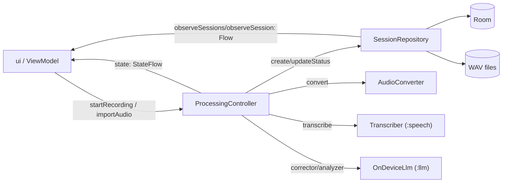

# Архитектура модуля `:app`

**OnWin** — офлайн-приложение для Android, которое превращает аудиозаписи разговоров в
текст с автоматическим определением говорящих и таймкодами. Распознавание, диаризация
и локальная LLM-постобработка выполняются целиком на устройстве, без интернета.

Модуль `:app` — это пользовательский слой и оркестратор всего решения. Он связывает
готовые движки `:speech` (ASR + диаризация) и `:llm` (локальная LLM) в единый продукт:
UI, навигация, очередь обработки, хранение, foreground-сервис и экспорт.

---

## Слои модуля

Приложение построено по трёхслойной схеме с направлением зависимостей **снаружи внутрь**:

```
┌────────────────────────────────────────────────────────────┐
│  ui        Compose-экраны, ViewModel, навигация, уведомления │
└───────────────▲──────────────────────────▲──────────────────┘
                │                          │
        domain  │  модели, контракты,       │  очередь обработки
                │  repository-интерфейсы    │  (ProcessingController)
┌───────────────┴──────────────────────────┴──────────────────┐
│  domain     Session, SessionRepository, ProcessingController │
└───────────────▲─────────────────────────────────────────────┘
                │
┌───────────────┴─────────────────────────────────────────────┐
│  data       Room, DataStore, аудио (декод/конвертация),      │
│             репозитории-реализации, экспорт                  │
└─────────────────────────────────────────────────────────────┘
```

- **`ui`** — Compose (Material 3), MVVM на `ViewModel` + `StateFlow`, навигация через
  Navigation Compose с типобезопасными `@Serializable`-маршрутами. Нижняя панель
  вынесена в общий `OnWinNavigationLayout`, чтобы она переживала переходы между
  экранами и плавно меняла высоту и содержимое.
- **`domain`** — чистая логика без Android и Room: модели сессий
  (`Session`, `SessionStatus`, `ErrorCode`), контракты хранилищ и **контроллер
  обработки** — единственный владелец очереди записи и расшифровки.
- **`data`** — реализация: Room, DataStore Preferences, декодирование и конвертация
  аудио, репозитории, экспорт в JSON/PDF/Markdown/TXT и протокол.

Внешние границы: `:speech` даёт `Transcriber` / `StreamingTranscriber` и модели анализа
(`Segment`, `TranscriptionEvent`, `TextCorrector`, `TranscriptAnalyzer`, `ProtocolAnalyzer`);
`:llm` собирает их на одном генераторе через `OnDeviceLlm`.

---

## Ключевые компоненты

### 1. Очередь обработки — `ProcessingController`

Сердце модуля. `DefaultProcessingController` живёт в масштабе приложения (singleton в
Hilt) и переживает пересоздание `Activity`.

- Один **FIFO-очередь** и один **воркер**: двух расшифровок одновременно не бывает.
- Модели ASR грузятся один раз на пачку заданий и выгружаются, когда очередь опустела.
- **Захват микрофона** идёт независимо от очереди и резервирует место в ней при старте,
  поэтому запись возможна во время обработки другого файла.
- Сегменты пишутся в Room по мере готовности; статусы и сегменты переживают смерть
  процесса. При старте контроллер помечает брошенные сессии `INTERRUPTED` и удаляет
  осиротевшие WAV.

Каждое задание — отдельная корутина; отмена пишет итоговый статус (`CANCELLED` или
`FAILED`), не задевая воркер.

### 2. Конвейер задания

```
аудио ──► WAV ──► ASR/диаризация ──► LLM-коррекция ──► анализ ──► DONE
  │         │           │                 │               │
  │      конвертация  сегменты          правка          имена спикеров
  │      в 16 кГц     пишутся в БД      реплик          + «Кратко»
```

- **Конвертация** — `AudioConverter`: `MediaExtractor` → `MediaCodec` → `PcmPipeline`
  в канонический WAV (16 кГц, моно, PCM16). Любой формат идёт одним потоковым путём,
  память не зависит от длины файла; для WAV без `audio/raw`-декодера есть запасной
  `RiffWavReader`.
- **Распознавание** — через `Transcriber` из `:speech`: диаризация + ASR, сегменты
  приходят потоком.
- **LLM-постобработка** — опциональна. Порядок важен: сначала выгружаются модели ASR,
  затем грузится 0,5B-модель — иначе GigaAM, embedding-модель и LLM окажутся в памяти
  одновременно. Ошибки этапа не роняют сессию: исходный текст ASR всегда валиден.
- **Протокол** — `ProtocolService` запускается отдельно, только по действию
  пользователя, не занимая очередь ASR.

### 3. Фоновая работа

`ProcessingService` — тонкая foreground-оболочка над контроллером: держит процесс на
переднем плане, показывает прогресс в уведомлении и передаёт команды «Стоп»/«Отмена».
Типы: `microphone` при записи, `mediaProcessing` (API 35+) или `dataSync` (API 29–34)
при обработке. WakeLock держит CPU при выключенном экране. На Android 15 лимит времени
обрабатывается через `onTimeout`.

### 4. Хранение

- **Room** (v3, схема в `app/schemas`): сессии, сегменты, имена спикеров, заметки LLM
  и протокол. Миграции 1→2 и 2→3 версионируются и проверяются.
- **DataStore Preferences** — флаг приветствия и подсказки.
- `RoomSessionRepository` — реализация `SessionRepository`, хранит строки в БД и WAV в
  `filesDir/recordings`, преобразует entity в модели `domain`.

### 5. Сборка зависимостей — Hilt

`AppBindings` собирает граф приложения: Room, репозиторий, контроллер, `Transcriber`,
`OnDeviceLlm?` (null — без модели функции LLM просто отключены), конвертер и микрофон.
`OnWinApp` инжектирует контроллер при старте процесса, чтобы сразу запустить
восстановление незавершённых сессий.

---

## Поток данных (кратко)



---

## Технологии

| Категория | Стек |
|---|---|
| UI | Jetpack Compose, Material 3, Navigation Compose (типобезопасные маршруты) |
| Архитектура | MVVM, `ViewModel` + `StateFlow`, корутины + `Flow` |
| DI | Hilt |
| Хранение | Room (v3, экспорт схемы), DataStore Preferences |
| Аудио | `MediaExtractor` / `MediaCodec`, `AudioRecord`, потоковый ресемплер |
| Движки | `:speech` (sherpa-onnx, ASR + диаризация), `:llm` (ONNX Runtime GenAI 0.19) |
| Сериализация | kotlinx.serialization |
| Экспорт | JSON, PDF, Markdown, TXT |
| Офлайн | разрешения `INTERNET` / `ACCESS_NETWORK_STATE` удалены из merged-манифеста |
